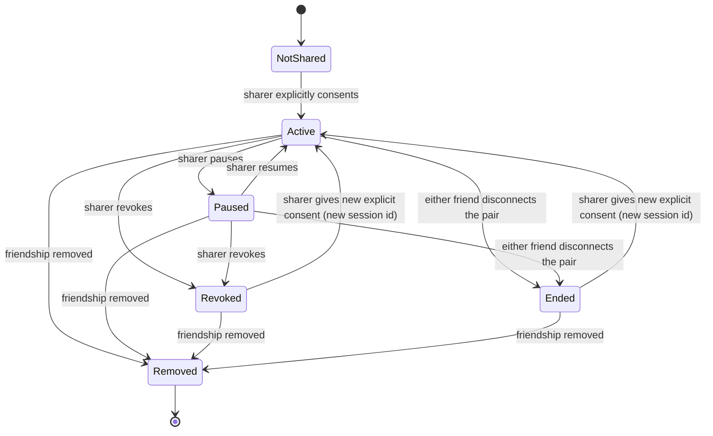
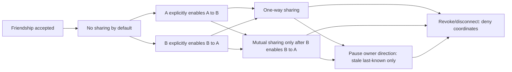

# Connect Friends — Product Specification and Privacy Design

**Status:** Phase 0 specification for review. This document does not implement application or backend functionality.

**Scope:** Accounts, friend connections, explicit location sharing, privacy controls, and live friend markers on the existing Route Tracker map. Personal journey recording, history, playback, and GPX data remain local and are outside the social backend.

## 1. Product principles and terminology

1. A friendship and a location-share permission are separate. Accepting a friend request never starts location sharing.
2. Sharing is directional. `A shares with B` means B may retrieve A's current or permitted last-known location. B sharing with A requires separate consent by B.
3. Authorization is checked by the database/server on every location read and write. The UI, cached friend list, channel subscription, and client-supplied user IDs are not authorization boundaries.
4. The social backend stores only one latest coordinate record per user, never a sequence of route samples. Journey history and raw GPS samples remain in the existing IndexedDB service.
5. A location is called **live** only when the share is active and the server received a valid measurement within the live freshness window. Older records are **last known / stale** and visibly labeled with age/time. No stale coordinate is styled as live.
6. Revocation, disconnection, or relationship removal immediately denies subsequent location reads. A coordinate already viewed, copied, photographed, or otherwise retained by a recipient cannot be recalled.
7. Existing screens, typography, colors, spacing, and navigation layout remain in place. Connect Friends is additive and uses existing application patterns.

### Proposed freshness and retention defaults

These are specification defaults to approve before backend launch:

- Live freshness window: 60 seconds since server receipt.
- Last-known retention: 24 hours since server receipt. Expired rows are not returned and are deleted by scheduled cleanup.
- Location publication cadence: target one update every 15 seconds while sharing is active and the device has a fresh valid fix; send sooner only if a product-approved movement threshold is defined. A server-side minimum interval/rate limit prevents abusive write rates.
- Maximum accepted client capture-time skew: 2 minutes in the past and 30 seconds in the future. `received_at` always comes from the database clock.

These thresholds are configurable policy constants, not promises of a 15-second GPS fix. Browser/device throttling and network loss can make updates much less frequent.

**Paused sharing behavior:** no new coordinate writes are accepted for that recipient. The last-known coordinate may remain visible to that recipient as explicitly stale/paused until its 24-hour expiry, unless the user chooses Disconnect or Revoke. This makes Pause different from a privacy revocation; the UI must say so before the user confirms Pause.

## 2. Complete user flows

### 2.1 Registration, login, and logout

1. A signed-out user opens the additive Connect Friends entry point. The app explains that an account is required for friend connections and sharing; local recording remains available without one.
2. Registration uses a product-selected Supabase Auth method (recommendation: email one-time code or magic link for the first release; password support is a separate product decision). The user verifies control of the address, selects a unique username, and sees a clear privacy explanation before entering friend discovery.
3. Profile creation is linked to `auth.users.id`. Email is not exposed in the friend lookup or friend list.
4. Login restores the Supabase session and loads the caller's profile, requests, friendship list, sharing states, and eligible locations. Until the authorization state is confirmed, the map shows no friend coordinates.
5. Expired/invalid authentication stops location publication, closes local Realtime subscriptions, clears remote friend data from memory, and requests sign-in. Local GPS recording continues independently.
6. Logout immediately stops the local publisher, unsubscribes channels, clears friend locations from React state, and calls an authenticated stop/cleanup operation where connectivity allows. Server authorization still denies reads once the token is expired or the user session is revoked. Current-location rows naturally become stale and expire if the device is offline.

### 2.2 Friend discovery and invitation

Initial release supports exact username lookup and a high-entropy invitation code; it does not expose a browsable user directory.

**Username path:**

1. Signed-in user enters an exact username.
2. Server normalizes and rate-limits lookup; it returns only the minimal public profile identifier and username, or a generic no-result response. It does not reveal email, online state, or location.
3. User confirms the recipient and sends a request.

**Invitation-code path:**

1. User generates a random, one-time code and chooses an expiry (default 24 hours). The UI displays/copies it and explains that anyone holding it can initiate a request, but not become a friend without acceptance.
2. The backend stores only a cryptographic digest of the code, not the redeemable plaintext.
3. Recipient signs in, enters the code, and asks to send a request. The server validates expiry and one-time state in a transaction, consumes the code, and creates a pending request. Redemption never auto-accepts.
4. Expired or consumed codes return a generic invalid/expired result. Reissuing creates a new code and invalidates the previous one.

The exact username lookup should be private by default and protected by per-user and network-level abuse controls. Invitation codes are preferred for people who do not want their account discoverable by arbitrary username searches.

### 2.3 Friend requests, acceptance, decline, and removal

1. Sender sees pending/sent state. Recipient sees an in-app incoming request with the sender's username and explicit Accept and Decline actions.
2. Accept performs one server transaction: verifies the caller is the recipient, marks the request accepted, creates the canonical friendship row, and emits a non-sensitive notification/invalidation. It does not create a sharing permission.
3. Decline marks the request declined. Sender is not told whether the recipient declined versus did not find/respond (product notification detail to decide); the sender cannot mutate the recipient's decision.
4. Cancel is available only to the sender while pending.
5. Crossed requests are not auto-accepted. If a pending request already exists in the opposite direction, the API returns that incoming request to the caller so they can explicitly Accept or Decline it.
6. Remove Friend requires a confirmation. It atomically deletes the friendship and both directional share grants, stops sharing access for the pair, removes any local cached marker immediately, and causes subsequent location reads to fail authorization. Location rows remain only if needed for other entitled friends; otherwise they are deleted.

### 2.4 Explicit one-way and mutual sharing

1. On a friend card, A sees separate state: **A shares with B** and **B shares with A**. Each is independently controlled by its owner.
2. A selects **Share my location with B**. The app explains current/last-known visibility and data freshness, then asks for explicit confirmation. Only after confirmation does the server create/activate A→B consent.
3. If device location permission is absent, the app asks for foreground location permission when the user enables sharing. Denial leaves the friendship intact and sharing inactive; it does not silently fall back to a stale marker as live.
4. B's location becomes visible to A only if B independently enables B→A. One-way use is supported; mutual sharing is represented by both directional permissions being enabled.
5. The app publishes only fresh, validated current measurements while at least one relevant directional share is active. It sends no route, past samples, speed history, or journey metadata.
6. The map shows a friend's live marker only when the share is currently active and `received_at` is within the live window. It shows stale/last-known separately, with a timestamp and stale style. At expiry, it shows no coordinate.

### 2.5 Pause and resume

1. The sharing owner pauses a specific outgoing share from the friend card. Confirmation explains that updates stop immediately and the recipient may continue to see the last-known point as stale until its retention expiry.
2. Backend changes that directional grant from `active` to `paused`. The publication operation refuses new location writes for that target. When the owner has no other active shares, the publisher may stop obtaining fixes solely for sharing (local recording can still obtain fixes).
3. Recipient labels the point `Paused`/`Last known`, includes its last update time, and never renders it as live. At 24 hours after server receipt, the location read operation omits it and cleanup deletes the row if no other share needs it.
4. Owner resumes from the friend card. The server reactivates the existing unrevoked consent. Fresh current updates resume. Until a new update arrives, the old coordinate remains stale and cannot be promoted to live.

Pause is not revoke. If the user wants location hidden immediately, use Revoke or Disconnect.

### 2.6 Disconnect, revoke, and remove

- **Revoke my sharing:** the sharer ends their outbound permission to one friend immediately. It does not affect the other direction. Any new location read by that friend is denied. A new share requires a new affirmative action and consent timestamp.
- **Disconnect sharing with this friend:** ends both directions for the pair but keeps the friendship. Both directions must be enabled again with fresh consent. This action is available to either friend because either person can end the pair's sharing session; neither may re-enable the other person's direction.
- **Remove Friend:** deletes the friendship and both directional shares. Existing friends list and markers update. Re-connecting requires a new request and acceptance.
- **Global sign-out/account deletion:** sign-out stops this device's publisher and client subscriptions. Account deletion removes profile, friendship requests, friendships, consent records, and location rows through database cascades/controlled deletion. If the user is the sharer, all recipients immediately lose subsequent read access.

The UI must distinguish Revoke (my direction), Disconnect (both directions, friendship remains), and Remove Friend (relationship ends).

## 3. State-transition diagrams

### 3.1 Request and friendship states

```mermaid
stateDiagram-v2
    [*] --> Pending: send request / redeem invite
    Pending --> Accepted: recipient accepts + friendship row created atomically
    Pending --> Declined: recipient declines
    Pending --> Canceled: sender cancels
    Pending --> Expired: expiry cleanup / request operation
    Accepted --> FriendshipActive: created by same transaction
    FriendshipActive --> Removed: either member removes; both share directions revoked
    Removed --> [*]
    Declined --> [*]
    Canceled --> [*]
    Expired --> [*]
```

An accepted request is historical request state; the current relationship is the friendship row. There is no direct client write that can manufacture either state.

### 3.2 Directional location-share states

Each friend pair has two independent machines, A→B and B→A:

`Revoked`, `Ended`, and `Removed` deny reads immediately. Re-enable is a new consent, never an implicit resume. Paused shares allow only last-known data until expiry and do not authorize new writes.

### 3.3 Combined mutual sharing

## 4. Location freshness, expiry, and deletion rules

1. `received_at` is assigned by the database clock, not accepted from the client. `captured_at` is validated for plausible clock skew and is informational for freshness ordering.
2. On client display: `live` requires directional share state `active`, a location captured after that consent's start, and `now - received_at <= 60s`. Otherwise, if the directional state is active or paused and the record is less than 24 hours old, show it as **Last known** with age and stale styling. If the share is paused, show **Paused · Last known** even if under 60 seconds.
3. A share state that is revoked, ended, or removed yields no coordinate, including no last-known point. This is enforced by the read RPC, not by hiding a marker in React.
4. At 24 hours, location reads omit the row regardless of share state. A scheduled cleanup deletes expired location records. Cleanup is not the authorization control: the RPC also checks expiry so delayed jobs cannot expose expired coordinates.
5. On final share revoke/disconnect/remove, delete the location row when there is no other non-revoked friend who may access the owner's last-known point. If another friend still has active/paused consent, keep only the single latest row needed for that friend. Removing one friend never grants or revokes another friend's access.
6. Expired invite codes and completed/expired friend requests may be deleted after an operational retention period; they contain account relationship metadata, not coordinates. Choose a short retention and document it in the privacy notice.
7. No app-level location history is stored in the social database. Database backups/WAL/provider retention may retain prior physical versions beyond application-level row deletion; the project's backup retention and privacy disclosures must account for that limitation.

## 5. Proposed Supabase schema

Use UUIDs. Refer to `auth.users(id)` by foreign key but never expose or query email for friend discovery. Enable RLS for all exposed tables. Prefer `timestamptz` and server defaults. SQL below defines intent; migration syntax and exact grants are to be reviewed and tested before deployment.

### 5.1 `public.profiles`

| Column | Rules |
| --- | --- |
| `user_id uuid` | Primary key, FK `auth.users(id) ON DELETE CASCADE`; immutable. |
| `username text` | Display form; validated length and allowed characters. |
| `username_norm text` | Lowercase/canonical form, unique index. |
| `created_at timestamptz` | Server default, immutable. |
| `updated_at timestamptz` | Server-maintained. |

No email, coordinates, device tokens, or free-form private metadata in the profile. An Auth trigger or restricted RPC creates the profile; clients cannot change `user_id`.

### 5.2 `public.friend_invite_codes`

| Column | Rules |
| --- | --- |
| `id uuid` | Primary key. |
| `owner_id uuid` | FK to profiles, cascade on account deletion. |
| `code_digest bytea` | Unique digest of a cryptographically random one-time code; plaintext never stored. |
| `created_at`, `expires_at` | Server timestamps; expiry required. |
| `redeemed_at timestamptz nullable` | Set once in the same transaction that creates the request. |

Use an index on `(owner_id, expires_at)` and unique `code_digest`. A code is not itself a friendship or consent grant.

### 5.3 `public.friend_requests`

| Column | Rules |
| --- | --- |
| `id uuid` | Primary key. |
| `sender_id`, `recipient_id uuid` | FKs to profiles; distinct users. |
| `status text` | Check constraint: `pending`, `accepted`, `declined`, `canceled`, `expired`. |
| `created_at`, `updated_at`, `expires_at` | Server timestamps. |
| `responded_at timestamptz nullable` | Set on terminal response. |
| `invite_code_id uuid nullable` | Optional FK; no code plaintext. |

Constraints: sender differs from recipient; no duplicate pending request for an unordered pair using a unique partial index over `least(sender_id,recipient_id), greatest(sender_id,recipient_id)` where status is pending; indexes on `(recipient_id,status,created_at DESC)` and `(sender_id,status,created_at DESC)`. Request state transitions occur only through RPC.

### 5.4 `public.friendships`

| Column | Rules |
| --- | --- |
| `id uuid` | Primary key. |
| `user_low uuid`, `user_high uuid` | FKs to profiles, `user_low < user_high`. |
| `created_at timestamptz` | Server default. |

Unique `(user_low,user_high)` prevents duplicate relationships. Index each member column for friend-list queries. Removal deletes this row and cascades/transactionally removes the pair's sharing grants. If later requirements need audit of removals, use a non-location audit record with constrained retention rather than retaining relationship access.

### 5.5 `public.location_shares`

One row is one directional permission/session. A pair has at most two rows.

| Column | Rules |
| --- | --- |
| `friendship_id uuid` | FK to `friendships(id) ON DELETE CASCADE`. |
| `sharer_id`, `viewer_id uuid` | FKs to profiles; distinct and must be members of referenced friendship (enforced by RPC/trigger). |
| `session_id uuid` | Random new value for each fresh consent. |
| `status text` | Check: `active`, `paused`, `revoked`, `ended`. |
| `consented_at timestamptz` | Set at explicit enable; reset on fresh consent. |
| `updated_at timestamptz` | Server-maintained. |
| `ended_reason text nullable` | `revoked`, `disconnected`, or `friend_removed`; server-controlled. |

Primary key `(sharer_id,viewer_id)`. Index `(viewer_id,status,sharer_id)` and `(sharer_id,status,viewer_id)`. Direct writes are denied; procedures validate friendship and caller authority. Revoked/ended rows may be replaced/re-enabled only by a fresh affirmative action from `sharer_id`, which generates a new `session_id` and consent timestamp.

### 5.6 `public.live_locations`

At most one latest row per user; never append a route history.

| Column | Rules |
| --- | --- |
| `user_id uuid` | Primary key, FK to profiles with cascade. |
| `latitude double precision`, `longitude double precision` | Finite values; latitude `[-90,90]`, longitude `[-180,180]`. |
| `accuracy_m double precision` | Nonnegative finite value. |
| `captured_at timestamptz` | Validated client measurement time. |
| `received_at timestamptz` | Server `now()`, updated on every accepted location. |
| `expires_at timestamptz` | Derived from server receipt time and approved retention. |
| `sequence bigint` | Server incremented; prevents stale concurrent writes replacing a newer accepted write. |

Index `(expires_at)` for cleanup. No `journey_id`, route, history, speed series, or export linkage. RLS is enabled, but direct `SELECT`, `INSERT`, `UPDATE`, and `DELETE` grants to `anon`/`authenticated` are revoked. Coordinates are read only through an authorization-checking RPC and written only through the publish RPC.

### 5.7 Realtime authorization surface

Use Supabase-managed `realtime.messages` policies only for private invalidation channels; do not create tables in the managed `realtime` schema. The broadcast payload contains no coordinates, precise timestamp, sharer ID, or share state. It is only a generic “refresh your eligible friend locations” signal. Authorization policy allows authenticated clients to subscribe only to a topic derived from their own authenticated user ID. Direct browser inserts are denied; a database trigger/function emits invalidations only for current recipients of active shares.

## 6. Row Level Security and grants

RLS is enabled on every application table in the exposed schema. Grants are restricted separately; a policy does not grant access by itself. All direct client DML on relationship, consent, invitation, and location tables is revoked unless listed below.

| Table | SELECT policy | INSERT / UPDATE / DELETE |
| --- | --- | --- |
| `profiles` | Authenticated caller may directly select their own row only. Minimal target profile lookup uses `lookup_profile_by_username` RPC, not broad table SELECT. | Insert only through sign-up trigger/restricted RPC. Update only own permitted display/username fields; never `user_id`. Delete through account deletion flow. |
| `friend_invite_codes` | No direct client SELECT. | No direct client DML. `create_invite_code` and `redeem_invite_code` RPCs only. |
| `friend_requests` | Authenticated caller may SELECT rows where they are sender or recipient. | No direct client DML. Send/accept/decline/cancel through validated RPCs only. |
| `friendships` | Authenticated caller may SELECT rows where their UID equals either member. | No direct client DML. Accept/remove/disconnect procedures only. |
| `location_shares` | Authenticated caller may SELECT rows where they are sharer or viewer and still belong to that friendship. | No direct client DML. Enable/pause/resume/revoke/disconnect RPCs only. |
| `live_locations` | No direct client SELECT policy/grant. Read via `get_friend_locations()` which rechecks auth, active friendship, share direction/state, consent time, and expiry on every call. | No direct client DML. Write via `publish_location()`; deletion/expiry via constrained server operation. |
| `realtime.messages` | Private channel read policy permits only the signed-in user’s own invalidation topic. Payload is non-sensitive. | Deny direct user insert; DB trigger emits invalidation messages. No public channels for location data. |

RLS test requirements: for every table, test unauthenticated, owner, friend, unrelated authenticated user, and removed/revoked user. Test each operation separately. For RPCs, test wrong caller IDs, replayed tokens/codes, duplicate transitions, removed friendships, stale share sessions, and malformed input.

### RPC and function hardening

- Expose only the required RPC functions to `authenticated`; explicitly revoke execute from `public` and `anon`.
- Every function derives the caller from `auth.uid()`. It must not trust `user_id`, `sender_id`, or consent status supplied by the browser.
- Use `SECURITY DEFINER` only where necessary to enforce atomic transitions or return protected coordinates. Set an empty/fixed `search_path`; schema-qualify relations and functions; validate all inputs; avoid dynamic SQL.
- Ensure function owner and grants are controlled. Never send a Supabase secret/service-role key to the browser. Server-only secret keys, if any are needed for account deletion/maintenance, belong in a protected Edge Function secret store and must not be used for routine client requests.
- Avoid authorization decisions based on `user_metadata`, which the user may edit. [Supabase RLS guidance](https://supabase.com/docs/guides/database/postgres/row-level-security)

## 7. Secure operations

### 7.1 `lookup_profile_by_username(username)`

Requires an authenticated caller; normalizes input, rejects self lookup, returns only a minimal profile result, applies lookup rate limits, and uses a generic not-found response. Do not return email, friend status beyond necessary UX, online presence, or coordinates. Implement rate limits at an authenticated API/Edge Function boundary and/or database counter with abuse monitoring.

### 7.2 `create_invite_code()` / `redeem_invite_code(code)`

Create uses cryptographically secure random bytes, stores a one-way digest, expires/invalidates previous codes as specified, and returns plaintext once. Redemption hashes the supplied code, locks the matching code row, verifies expiry/unredeemed state and owner is not caller, marks it redeemed and inserts the pending request in one transaction. Unique pending-pair constraints resolve races. Response does not disclose whether an arbitrary account exists.

### 7.3 `send_friend_request(target_id)`

Caller is always `auth.uid()`. In one transaction: reject self; verify target exists; reject an existing friendship; if an inverse pending request exists, return that request for explicit acceptance rather than accepting it; return an existing same-direction pending request idempotently; otherwise create one pending row. Unique index is the final race guard.

### 7.4 `respond_friend_request(request_id, decision)`

Lock the request row; verify it is pending and caller is recipient for accept/decline. Accept inserts canonical friendship and marks request accepted atomically. Decline marks declined. Only sender can cancel. A replay returns the already-achieved result only when the same authorized party and decision match; conflicting replay is a state conflict.

### 7.5 `set_location_share(friendship_id, action)`

Enable/resume/pause/revoke validates caller's role and friendship existence. Only the sharer may enable/resume/revoke their outgoing direction. Either member may disconnect the pair, which ends both directions. Remove deletes the friendship and both shares. Consent transitions and invalidation are transactional. Revoke/disconnect/remove deny the next coordinate read immediately.

### 7.6 `publish_location(latitude, longitude, accuracy, captured_at)`

Caller derives from `auth.uid()`. Validate finite coordinates, accuracy and timestamp bounds, and require at least one active outgoing share. Paused-only users cannot publish. Lock/upsert the single latest row, reject an out-of-order capture timestamp, increment the server sequence, assign server `received_at` and `expires_at`, and overwrite the prior current row. No append table is written. The accepted row update triggers generic invalidations for active recipients only; never the coordinate payload.

The server cannot prove that a client coordinate came from a genuine GPS sensor. Client validation, plausible accuracy/time limits, rate limits, and anomaly controls reduce abuse but do not make a compromised device trustworthy.

### 7.7 `get_friend_locations()`

Requires an authenticated caller, takes no arbitrary target list, and derives the caller's entitled friends from friendships and their inbound active/paused share rows. It returns rows only when not expired and captured after that viewer's current consent timestamp. Revoked, ended, removed, or unrelated users get no row. The operation executes the full authorization query on every request; it must not rely on a cached React list or Realtime channel authorization.

### 7.8 `disconnect_friend_sharing(friendship_id)` / `remove_friend(friendship_id)`

Verify caller is one of the two members; atomically end/delete the two directional permissions, prevent later location reads, and remove a location row only when no other friend is entitled to its last-known value. Remove additionally deletes the friendship. Client caches and subscriptions are cleared immediately, while database authorization remains authoritative even if the client is malicious or disconnected.

## 8. Realtime architecture and revocation safety

1. Use private Supabase Realtime channels. Do not put raw locations, exact timestamps, user IDs, or route data in Broadcast/Presence payloads.
2. Database writes to the latest-location row produce a generic invalidation event for each currently eligible recipient. The event says only “refresh your permitted friend locations.” Prefer a recipient-scoped topic and current database authorization for event production. `realtime.messages` RLS restricts each client to its own topic.
3. On invalidation, the client calls `get_friend_locations()`. That RPC re-evaluates current friendship, directional consent, share status, consent timestamp, and expiry. The coordinates are returned only by this authorization-checked request.
4. On revoke/disconnect/remove, the server transition commits first. Subsequent RPC requests return no location, even if a stale socket remains subscribed or a channel's authorization cache has not refreshed. The UI also immediately removes the coordinate and unsubscribes locally.
5. Any stale channel authorization can at most deliver a generic invalidation signal, not coordinates or per-friend activity. After removal, the removed relationship is no longer eligible for future invalidations. Tokens/channel auth are refreshed and subscriptions are recreated on auth changes.
6. A marker is not live because a WebSocket is connected. Live status is calculated from server update freshness and active consent. Network disconnection or missed events triggers periodic refresh/reconciliation; absence of Realtime does not imply that a friend stopped sharing.
7. Realtime authorization is cached for a channel connection according to Supabase documentation, so a design that broadcasts coordinates directly would risk post-revocation delivery. This design intentionally separates low-sensitivity invalidation from coordinate retrieval. [Realtime Authorization](https://supabase.com/docs/guides/realtime/authorization)

## 9. Error and offline behavior

| Condition | Required behavior |
| --- | --- |
| No network before login | Explain account features unavailable; local journey recording/history remains available. Do not fabricate friend state. |
| Network lost while logged in | Retain only in-memory friend data with an “offline / last updated” status; never label it live. Do not queue old coordinates for later replay. Reconnect and reauthorize before refreshing. |
| Sharing update request fails | Show “Sharing update failed” and last successful update time. Retry only a fresh fix while current consent still exists; do not silently queue a location sample. Continue local recording. |
| GPS permission denied | Keep account/friend features usable; disable outgoing sharing and explain the permission requirement. Incoming friend locations remain available if network/auth allow. Never substitute a default/fake coordinate. |
| GPS unavailable / poor fix | Do not publish invalid or stale coordinates. Keep prior eligible location as last-known until expiry, visibly stale. State the device's update problem to the sharer. |
| Auth session expires | Stop publisher, close channels, clear remote coordinates from memory and require reauthentication. Requests that fail with auth errors do not retry with an expired token. |
| Backend outage | Do not stop or corrupt the existing local GPS journey. Friends show unavailable or last-known with timestamp. Do not treat a local send as a server-committed location. |
| Request/share state conflict | Refresh server state and show a concise conflict message; do not optimistic-render a friendship/consent as committed. |
| Rate limit / quota | Back off, show last successful update time and sharing degraded state; never increase update frequency in a retry storm. |
| Invalid server response | Drop the invalid coordinate, log non-sensitive diagnostic metadata, and do not move the marker. Never log coordinates, access tokens, invite codes, or auth secrets. |

## 10. Future Android background GPS requirements

The current repository is a browser React/Vite application and contains no Capacitor project, Android manifest, native service, or background location plugin. Browser geolocation must not be represented as reliable screen-off tracking.

When Android support is separately authorized:

1. Add Capacitor deliberately and keep React UI/services as the application layer. Create a native Android location provider behind a provider interface compatible with the existing `GpsProvider` concept; do not duplicate route/statistics logic in Kotlin.
2. Start a native location foreground service only after a visible, explicit user action to begin sharing/recording. Show an ongoing notification with clear stop controls and foreground-service disclosure. Stop the service when relevant sharing/recording ends.
3. Declare foreground location permissions and a `location` foreground-service type. For Android 14+ target SDK, declare `FOREGROUND_SERVICE_LOCATION` in addition to `FOREGROUND_SERVICE` and the appropriate service type. Runtime coarse/fine location and system location enablement are prerequisites. [Android foreground-service types](https://developer.android.com/about/versions/14/changes/fgs-types-required)
4. If continuous access while the app is not visible is truly essential, evaluate `ACCESS_BACKGROUND_LOCATION` for Android 10+ separately, request it with contextual disclosure, and support the Android 11+ settings-based grant flow. Do not request background access by default. Google Play restricts background location to core features that meet policy. [Android location permissions](https://developer.android.com/develop/sensors-and-location/location/permissions), [background location request flow](https://developer.android.com/develop/sensors-and-location/location/permissions/background)
5. Start a while-in-use location foreground service while the activity is visible unless the app has the required background access/exemption. Android 14 enforces the location service prerequisites and may throw if a restricted service is started from background. [Background FGS restrictions](https://developer.android.com/develop/background-work/services/fgs/restrictions-bg-start)
6. Persist native GPS callbacks locally first through the Phase 1 reliability pipeline, then upload only the latest point if a current outbound share is active. A network failure must not stop local recording or silently replay a backlog after consent changes.
7. Test process death, device reboot, force-stop, battery saver, approximate permission, permission revocation, notification stop action, Android API levels, and OEM battery management on physical devices. A foreground service improves continuity but does not guarantee GPS/network availability or prevent user/system termination.

## 11. Existing UI and MapLibre integration contract

1. Preserve the current `NavShell` desktop header and 64px, three-item mobile bottom bar in [`src/components/NavShell.tsx`](src/components/NavShell.tsx). Do not redesign/relabel the current Live Track, History, or Settings destinations.
2. Extend `AppRoute` and `App.tsx` with a Friends sub-screen route. Reach it through a compact Friends action placed in the existing Live Tracking screen's visual chrome, using the current button shape, border, typography, and icon style. The Friends screen provides a matching back action to Live Track. On mobile the existing Live Track tab remains the active section; do not add a fourth bottom-nav item or alter the grid layout.
3. Keep `LiveTrackingScreen` and `JourneyMap` as the existing map owner. Extend the existing live screen props with a friend-location collection. In `JourneyMap`, add distinct GeoJSON source/layers such as `friend-locations` and `friend-location-markers`; never reuse `current-point`, `active-route`, or playback sources for friends.
4. Use feature properties for friend identifier, display name, server receipt time, share status, and freshness state; never send those private server fields to journey data. A feature-level click/selection may show a small popup/card using existing app styling. Cluster only if later performance testing demonstrates need.
5. Friend visibility controls only friend markers. Hiding a friend route/visualization must not stop location sharing; this phase has no friend route/history, only point markers. User's own recording, current marker, accuracy circle, follow mode, history, playback, GPX, theme, and unit behavior remain unchanged.
6. The global React/app layer owns auth/friend service subscriptions. MapLibre receives already-authorized, presentation-ready data and has no Supabase credentials or authorization responsibility.

## 12. Test scenarios and acceptance criteria

### Account and discovery

- Register, verify, login, restore session, logout, expired session, deleted account.
- Duplicate normalized username; invalid username; account without profile; no email disclosure.
- Valid/expired/redeemed/revoked invite code; concurrent redemption; brute-force/rate-limit behavior.
- Exact username lookup; not-found response does not confirm private account details.

### Requests and friendships

- Send, receive, accept, decline, cancel, expire; only authorized party can transition.
- Self-request, duplicate request, crossed request, duplicate accept, accept after expiry, and simultaneous send race.
- Remove by either side; both directional consents stop; unrelated friendship unaffected.
- Direct REST attempts to insert/alter/delete request or friendship rows are denied.

### Consent and sharing

- Friend acceptance creates zero share rows and exposes zero coordinates.
- A→B only; B→A only; mutual only after both explicit actions.
- Pause rejects new writes and displays retained last-known as stale; resume requires a new fresh update before live label.
- Revoke, disconnect, remove, logout, permission denial, and session expiry stop publishing and prevent subsequent reads.
- Re-enable after revoke uses a new consent timestamp; coordinates captured before that timestamp are not returned.
- One friend is revoked while another remains authorized; the authorized friend continues to receive the single current point.
- Sender and recipient receive no route samples or location trail from backend queries.

### Location and Realtime

- Freshness boundaries at 59s/60s/61s, paused state, 24-hour expiry, stale cleanup lag, invalid/NaN/out-of-range coordinates, implausible accuracy, future/stale capture timestamps, out-of-order updates, and two concurrent publishers.
- Realtime channel payload inspection confirms no coordinates/precise timestamps/identity; unsubscribed/revoked client can receive at most generic invalidation and its next location RPC returns no coordinate.
- Attempt to call `get_friend_locations` with forged IDs, with no relationship, after revoke, after remove, after expiry, and while unauthenticated.
- Offline/reconnect does not queue old samples; local recording remains operable.

### RLS and operational security

- For every table test SELECT/INSERT/UPDATE/DELETE with anon, row owner, friend, unrelated authenticated user, and removed user.
- Test RPC authorization and function grants independently from UI.
- Confirm service-role/secret keys absent from source, Vite output, network responses, and client environment.
- Confirm location deletion, expiry, account deletion, database backup retention, logs, and diagnostic redaction.

### UI and regressions

- Screenshot/visual regression at existing mobile and desktop sizes before/after; current navigation dimensions, colors, typography, and existing screens remain unchanged.
- Friends management and back navigation; recording continues when navigating to Friends and back.
- Multiple friend markers, overlapping markers, marker selection, current user marker and accuracy circle coexist, stale style/timestamp, no friends, share hidden, map tiles offline.
- Journey recording, history, playback, GPX import/export, local settings, and map theme function while signed out and while backend is unavailable.

### Future Android tests

- See §10; physical device/emulator permission scenarios and process/background tests are mandatory before claiming reliable background GPS.

## 13. Unresolved decisions requiring approval

1. Confirm account sign-in method (email OTP/magic link recommended for initial release, or password/social sign-in).
2. Confirm whether username lookup is enabled, invite-code-only, or both; choose discoverability and rate limits.
3. Approve or change the proposed 60-second live threshold, 24-hour last-known retention, 15-second target publication cadence, and timestamp skew bounds.
4. Confirm Pause retains a stale last-known point until expiry; confirm Revoke/Disconnect hide it immediately.
5. Confirm Disconnect ends both directional shares but preserves friendship, while Revoke ends only the actor's outbound direction.
6. Decide what the recipient sees when a request is declined and whether requests expire after a fixed period (proposed default: 30 days).
7. Decide whether account deletion is self-service immediately or includes a grace period; retention and backup deletion timing must be disclosed.
8. Confirm whether the initial release targets browser only, with Android native tracking specified for a later milestone as above.
9. Decide whether Supabase project hosting region, backup retention, and data-processing terms meet the product's privacy/legal requirements.

## 14. Recommended implementation sequence after Phase 0 approval

1. Finalize the unresolved privacy/product values and threat model.
2. Create backend schema/migrations and comprehensive RLS/RPC tests before connecting a client.
3. Implement account/profile lifecycle without changing local journey storage.
4. Implement friend discovery, requests, and relationship operations.
5. Implement directional consent, latest-location publication/read RPCs, expiry and revocation-safe invalidations.
6. Add the Friends sub-screen and integrate friend data into existing MapLibre layers without touching user route/playback layers.
7. Run multi-account security, RLS, offline, stale/revoke, UI regression, and browser/device tests.
8. Consider Capacitor/native Android only after browser Connect Friends passes its separate acceptance criteria and is separately authorized.
